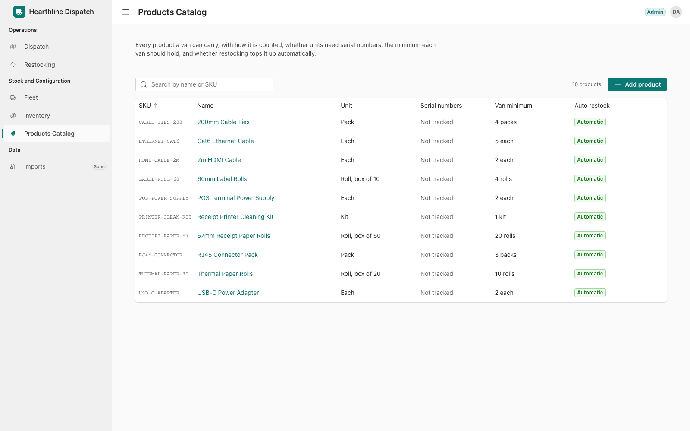

# Hearthline Dispatch

The van stock and dispatch system. Milestone 1 is the backend: database, business rules, import of the stock book, and an HTTP API. The UI (Microsoft Fluent 2) has a secure sign-in screen, the application shell, a Dispatch board with manual assignment and scheduling, a read-only Restocking page, a Products page with create, edit and delete, and an Inventory page for receiving, corrections, serial verification and transfers. See [UI](#ui-fluent-2).

## Application preview



_The Products Catalog shows the shared application shell and seeded product configuration data._

## Demonstration Videos

[▶ Watch the full Hearthline Dispatch explainer playlist on YouTube](https://www.youtube.com/playlist?list=PLXJaXrm5tiFI)

### 00 · Introduction

[](https://youtu.be/G9qsRD3-vBw)

### 01 · Stock belongs to the van, not the technician

[](https://youtu.be/-BoYvD-F2kU)

### 02 · Car-park swaps are recorded as transfers

[](https://youtu.be/Q3NSlKseyZ0)

### 03 · What counts toward a restock

[](https://youtu.be/wESJpxwznfI)

### 04 · Kitchen displays: restocking off, flagged for review

[](https://youtu.be/PI04svb_xfg)

### 05 · Dead units inside the book's counts

[](https://youtu.be/Iw7h1BAlBZs)

### 06 · Serialised stock without serials needs verification

[](https://youtu.be/IZS6WFIjvaw)

### 07 · Repeated counts: the latest count wins

[](https://youtu.be/gmdSIFmGqe4)

### 08 · V01 in the garage, Khalid in the pool van

[](https://youtu.be/V5jQnpPZ67g)

### 09 · Unclear statuses are held for review

[](https://youtu.be/wVAkwx0K-To)

### 10 · Booked visits go through normal assignment

[](https://youtu.be/ayglPArD5As)

### 11 · Smaller calls: dates, "today", repair wording, customer names

[](https://youtu.be/MsyDbILJCHs)

### 12 · Hub stock isn't counted

[](https://youtu.be/4pQrqLgR-FI)

## Run it

Needs Node 20+ and Docker.

```bash
npm install                      # also generates the Prisma client
cp .env.example .env
npm run db:up                    # Postgres 17 on :5433 (dev + test databases)
npm run db:migrate               # apply migrations
npm run import:book -- docs/04-van-stock-book.xlsx
npm run dev                      # app at http://localhost:3000, API at /api
```

Open http://localhost:3000. It redirects to sign-in. First apply migrations and provision the Admin and Operations accounts using [Authentication setup](docs/authentication.md). Both accounts have full access.

After pulling updates, stop the development server and run `npx prisma migrate deploy` followed by `npx prisma generate`, then restart with `npm run dev`. These commands use `DATABASE_URL` from the environment (or `.env`); ensure it targets the intended development database. The Inventory receipt migration adds nullable `stock_movements.operationKey` and its unique index: historical movements retain `NULL`, while new receipt keys prevent duplicate stock on retries. Do not reset an existing database to apply this upgrade.

Checks: `npm test` (uses and wipes `hearthline_test`), `npm run typecheck`, `npm run lint`, `npm run build`. The component tests alone need no database: `npx vitest run --project ui`.
The import runs once into an empty database; to load it again run `npm run db:reset` first.

## Architecture

One Next.js app (App Router, TypeScript). Route Handlers are the API; all logic lives in server-only modules.

```
app/api/**/route.ts   HTTP only: validate with a contract → call one service → { data } | { error }
lib/contracts/        Zod request schemas + response types, shareable with the future UI
server/http/          AppError (code → HTTP status), handle(), readJson()
server/db/            Prisma client, runInTransaction(), row-lock helpers
server/modules/
  fleet/              vans, drivers, van status
  inventory/          availability rules, stock ledger, transfers, corrections, serial verification
  jobs/               create, schedule, start, cancel, complete
  dispatch/           van eligibility, assign/reassign, blocking reasons, dispatch board
  restocking/         restock formula, pick quantities, one open restock job per van
  import/             stock-book pipeline (independent of HTTP)
scripts/import-book.ts
prisma/schema.prisma, prisma/migrations/
tests/unit, tests/integration
```

Each module has a `*.service.ts` (business rules, transactions) and, where it helps, a `*.repository.ts` (queries) or a pure file (`availability.ts`, `eligibility.ts`, `restock-calculator.ts`, `pick-quantity.ts`, `import/plan.ts`) that holds the rule on its own so it can be tested without a database.

**How stock is represented.** Four facts are stored separately, so nothing is double-counted:

| Fact | Where |
| --- | --- |
| Physical quantity | `StockBalance` per location × product × condition (`WORKING` / `BROKEN`) |
| Serial verification | `EquipmentUnit.verification` (serialised products: one row per physical unit) |
| Reservations | `Reservation` (promised to a job; never subtracted from the balance) |
| History | `StockMovement` (every balance change, with both ends) |

`available = assignable working stock − active reservations`, where "assignable" means verified units for serialised products. Broken stock is never available.

**One writer.** `inventory/stock-ledger.ts#moveStock` is the only code that changes balances. In the caller's transaction, it updates the balance, the unit rows, and writes the movement.

**Concurrency.** Every operation that affects availability locks rows in a fixed order: job → van locations (sorted by id) → restock job. "Check availability, then reserve" therefore runs one transaction at a time per van, and reassignments in opposite directions cannot deadlock. The concurrency tests fail if the location lock is removed (checked). Completion locks the job first; a completed job returns `alreadyCompleted: true` and touches nothing. `JobCompletion.jobId` is also unique as a backstop.

**Blocking reasons** (`NO_ELIGIBLE_VAN`, `UNITS_NEED_VERIFICATION`, `IMPORT_NEEDS_REVIEW`, and `RESERVATION_SHORTFALL` for assigned jobs whose van no longer covers their reservations) are separate from job status. Open requests and assigned jobs are re-evaluated after every stock or reservation change. This runs after the change commits, in its own transaction, so it can neither deadlock with nor roll back the operation. Dispatch stays manual: nothing is auto-assigned.

## Decisions where the material disagreed or was silent

| Question | Decision | Why |
| --- | --- | --- |
| Is stock the van's or the technician's? (Noor vs Faris) | The van's. Changing driver moves nothing; moving stock is a recorded transfer. | The hub issues against plates and counts by vehicle; the restock list must go to the right van. |
| Car-park swaps (Daniel vs Noor) | Allowed, and recorded as one movement naming both vans. | Forbidding them didn't stop them; it produced V03's −2 terminals. |
| What counts toward a restock | Working physical stock only: dead units excluded, reservations not subtracted, 3 June minimums (the board says they supersede), paper in rolls with a 2-box minimum = 100 rolls. | Each of the three numbers (3/4/6 vans) was missing one of these. The import gives **6 vans**: P1, V02, V03, V04, V05, V07. Pavel's stale cable minimum no longer triggers. |
| Kitchen displays | Automatic van restocking off, flagged for review. Stock and jobs are unaffected. | Only the hub manager wants them off the list; nobody has agreed. |
| Dead units inside the book's counts | Identified by serial (pulled out minus dropped at hub) and moved from working to broken. | Faris says they get counted. This reproduces Casa Verde (V05: 3 printers, 2 dead) and Faris's 11 dead units (10 placed, plus 1 on a job with a blank status, held for review). |
| Serialised stock without serials | Imported as "needs verification" and not assignable until a serial is recorded (`POST /api/units/verify`). | This is the Casa Verde failure mode. **Consequence:** straight after import, every booked job needing hardware is blocked with `UNITS_NEED_VERIFICATION` and a list of what to verify. Recording serials at the next count unblocks them. |
| Repeated counts | Latest count per van/product by date (not row order); never summed. Only events strictly after that date are applied; same-day events are reported, not applied. | The sheet appends older counts at the bottom (V05 terminals). |
| V01 in the garage, Khalid in the pool van | V01's stock stays where the book says, flagged. Khalid is recorded as driving P1 (from the Read me). V01 jobs after 18 Aug have no stock effect. | Inventing the unrecorded move would hide it. Instead P1 goes negative on three products, which is flagged. |
| Unclear statuses (blank, "pending parts") and the 7 "Restock?" rows | Kept as written, held for review; no stock effect. | Guessing was the problem the brief describes. |
| Booked visits | Re-run through normal assignment after import. | A booking only becomes an assignment if the van can actually do it. |
| Smaller calls | "swap"/"fix" = repair (brief). Dates are day-first (UK); "today" is the London day. "مطعم زيتون" = Zaytoun Grill (same Riverside branch; flagged). Paper on job rows without a unit is left off and flagged. | |
| Hub stock | Not counted. The hub is a location that movements can name. | There are no hub counts to start from. |

## Import result (`docs/04-van-stock-book.xlsx`)

192 rows preserved with sheet and row number. 78 counts used (6 superseded), 99 movements, 51 completed jobs, 16 open requests, 6 open restock jobs. Issues: 50 info, 47 warnings, 1 error (V03 PRN-K, quantity "-"). Every issue links to its original row: `GET /api/imports/{id}/issues`.

## UI (Fluent 2)

Built with [Fluent UI React v9](https://react.fluentui.dev) (`@fluentui/react-components` 9.74, `@fluentui/react-icons`), Microsoft's React implementation of Fluent 2. It supports React 19 (peer range `<20`).

```
app/(auth)/sign-in/page.tsx    secure sign-in
app/(app)/layout.tsx           application shell around every signed-in screen
app/(app)/dispatch/page.tsx    Dispatch board
app/(app)/products/page.tsx    Products
components/theme/              the one theme (teal brand ramp → createLightTheme) and the Fluent/Next providers
components/shell/              sidebar, header, navigation config, media-query hook
components/sign-in/            screen + form
components/dispatch/assignment/  assign and schedule dialogs, van choice, schedule fields, their state (use-assignment), and
                               the board wiring (use-job-actions)
components/dispatch/           board (layout and selection), request list and details, van list and card, stock summary,
                               eligibility explanation, loading/error states, data hooks
components/restocking/         view (layout and selection), van list, pick list, broken returns, policy notice, states
components/products/           view (state), toolbar, table, details panel (with where the product is used), add/edit form and its fields,
                               delete confirmation, success notice, loading/empty/error states, hooks for the list, details, form and delete
lib/api/                       browser fetch of our own API, unwrapping { data } / { error }
lib/auth/sign-in.ts            form rules and the server sign-in client
lib/products/catalogue.ts      search and wording rules (pure, unit-tested)
lib/products/product-form.ts   form text → request, per-field errors (pure, unit-tested)
lib/products/references.ts     how the records that refer to a product are worded (pure, unit-tested)
lib/dispatch/presentation.ts   labels, dates and waiting-time states (pure, unit-tested)
lib/restocking/presentation.ts pick-quantity wording (boxes + rolls), job summaries (pure, unit-tested)
lib/dispatch/scheduling.ts     schedule form parsing and what a failed save means (pure, unit-tested)
lib/contracts/products.ts      ProductDto, the one input schema (server and form), ProductDetailDto
server/modules/products/       service (create/update/delete), product-rules (what is locked or blocked, pure), repository (reference counts)
```

Pages are server components that render one client component; Fluent is used only in client components. Business rules (`lib/`) don't import Fluent. To try another design direction, replace `components/` and the theme. The routes, `lib/` and the API stay as they are.

| Question | Decision | Why |
| --- | --- | --- |
| Sign-in | PostgreSQL-backed sessions, secure password hashes, authenticated pages and API routes, and server-verified audit identity. | Admin and Operations both have full access. See [Authentication setup](docs/authentication.md) for provisioning and rotation. |
| Fluent with the App Router | Fluent's documented setup: a Griffel renderer whose CSS is inserted into the server HTML through `useServerInsertedHTML`, so the first paint is styled. The `fluentui-next-appdir-directive` SWC plugin from the same guide isn't used. | Fluent 9.74 already ships `'use client'` in its modules, and Fluent is only imported from client components. A wasm SWC plugin is tied to one Next version. |
| Unfinished areas | Fleet and Imports appear in the sidebar with a "Soon" badge, as disabled (`aria-disabled`) buttons with an explanation. | Inventory, Restocking, Products and Dispatch have working screens. |
| Products table | Fluent `Table` with `useTableSort`, not `DataGrid`. Narrow screens show two columns (product + SKU, restock policy). | A read-only catalogue is a real `<table>` with sortable headers. Grid keyboard navigation is for interactive cells. |
| Restock policy display | A flagged policy shows its current setting *and* the flag ("Off · needs review"), plus the note in the details panel. | The kitchen-display decision is provisional (see above). Hiding either half would mislead. |
| Product data | Only what the products API returns. No demo fixtures. An empty database shows "No products yet" with how to import, or add the first product. | Everything shown is a real record. |
| Dispatch board scope | Requests waiting for a van, customer work already on a van (assigned or in progress), and every van that isn't sold. A waiting request can be assigned; an assigned job can have its day and position changed. Reassignment, cancellation and completion aren't on the board yet. | |
| Assigning from the board | "Assign to a van…" rechecks eligibility, then offers only vans the backend says can take the job (the rest are listed with reasons). It shows the technician and the job's equipment on the chosen van, asks for a confirmation, and calls `POST /api/jobs/{id}/assign`. That endpoint rechecks under the van's lock and reserves stock; the first schedule is saved in the same transaction. Success is shown only from the server's answer. | The board's eligibility can be minutes old, so the server stays the authority. A single transaction means there's no "assigned but not scheduled" half-state to recover from. |
| When a save fails | A stock, driver or vehicle change returns the dialog to the van list with the reason, and refreshes the board and eligibility. A refused schedule shows the server's message on the field. If the server doesn't answer, the UI re-reads the job: assigned to the chosen van means it was saved; still waiting means it wasn't, and you can retry. | The outcome is never guessed. Repeated submits are blocked while a request is in flight, and the server rejects assigning a job twice, so a retry can't create a second assignment or reservation. |
| Who assigned it | The dialog asks for your name, which the API records as `assignedBy`. It's remembered for the next assignment on that page. | There's no sign-in, and the API requires a named actor. |
| Scheduling rules (server) | A schedule is a calendar day plus an optional position in the van's day. New days can't be in the past (London today); keeping an existing past day, e.g. an imported visit, is allowed. A position needs a day and a van, and can't be one another job (not cancelled) already holds on that van that day. These are checked under the van's location lock, in the documented job → van order, so two saves can't take the same position. Changing a schedule never touches stock, reservations or the request date. | No time slots, durations, route optimisation or holiday rules exist, so none are invented. |
| Restocking page | Read-only. It lists each van's open restock job, sorted by van, with the technician, what to collect, broken units to return and products the policy leaves out. "To collect" is the backend's stored outstanding quantity (minimum − working stock, never below zero, recalculated inside every stock change); minimum and working stock are shown beside it. Paper shows as boxes plus rolls, always with the exact roll count; whole-box rounding appears only as a labelled alternative. Broken units are a separate section, never netted. Nothing on the page can collect or return stock. | Reading the list must never change inventory: only the existing confirmed-collection operation does. |
| Restock job data | `GET /api/restock-jobs` now also returns the van's status and technician, each item's `vanMinimum` and `working`, `brokenAwaitingReturn` (van broken balances, with serials where recorded) and `policyExclusions` (products below the minimum that automatic restocking skips, with the review flag and note). | The page needed these, and they come from data the service already reads. |
| Eligibility on the board | Selecting a waiting request calls `GET /api/jobs/{id}/eligible-vans`. Vans are shown in the backend's ranking (eligible, then the job's zone), and each van lists the backend's reasons and shortage figures. The UI doesn't compute eligibility or shortages itself. Assigned work shows its van and schedule instead. | One source of truth for the rules. For assigned work, the job's own reservation would make its van look short, so that check belongs with reassignment. |
| Waiting time | Shown from the API's `requestedOn` and `waitingDays`, as calendar days up to the board date. It is never taken from the scheduled date. A missing or unreadable request date, or one after the board date (two imported requests), is labelled as such instead of showing a number. | Waiting means how long the customer has waited since asking, whatever has been scheduled since. There are no working-day or holiday rules in the system, so the board shows no service-deadline or overdue indicator; the next-working-day promise isn't measured yet (see below). |
| Board stock | Per van: Working (physical), Reserved, Available, with broken units, units waiting for a serial and counts below zero noted beside the product. | Figures come from the API, where "available" already excludes broken, unverified and reserved stock. |
| Inventory operations | Inventory lists van stock and supports receipt into a van, audited count corrections, serial verification and transfers through the stock ledger. The server locks locations and updates balances, equipment, movements and restock data transactionally; receipts use an idempotency key. Unverified serialised units remain physical but unavailable. Warehouse shelf balances are not tracked, so the hub is labelled uncounted and cannot receive a stock balance from this screen. | Balances are never edited directly by the page. Hard deletion of recorded inventory is unsupported; use an audited correction. Missing-device reporting and recovery are a separate unfinished workflow. |
| Board layout | Desktop: compact oldest-first request queue alongside the selected request and van comparison rows. Historical details, full stock and run lists expand on demand. Inactive vans are grouped separately. Mobile: Details/Van choices inside one request drawer, with persistent context and an assignment/scheduling action. See [Dispatch cleanup](docs/dispatch-cleanup.md) for decisions, checks and before/after screenshots. |
| Product SKU | Canonical form is trimmed, **upper case**, letters and digits joined by single `-` `.` `_`, at most 32 characters. The one Zod schema (`lib/contracts/products.ts`) canonicalises it on the server and in the form; a database `CHECK` refuses any other form, which makes the existing unique index case-insensitive in effect. The friendly duplicate check runs first, and the unique index decides when two saves race (the loser gets the same field error). | `prn-80` and `PRN-80` must not both exist, and the database, not only the app, has to say so. The migration also keeps minimums non-negative and a pack to a name plus a size of at least 2. |
| Creating a product | Creates the product only: no balances, units or movements. If it has a minimum and automatic restocking, van pick lists are refreshed in the same transaction (vans holding none of it are below the minimum). | "Adding a product doesn't add stock." A new minimum is a policy, and pick lists must follow every policy change. |
| What can be edited | Always: name, pack name and size, minimum, automatic restocking. **Locked once any record refers to the product** (balances, movements, corrections, reservations, equipment, job lines, completion lines, restock lines or returns): SKU, unit, serial tracking. A locked field the request changes is refused with a reason beside the field, and nothing else in the request is saved. The details panel and form show the lock before anyone tries. | Quantities are stored in the base unit and serialised stock is backed by one equipment row per unit, so changing either would silently reinterpret numbers or strand units. The SKU is what movements, jobs and the stock book are read by. Pack name and size only change how a base-unit quantity is written (65 rolls as "1 box + 15 rolls"), so they are safe. |
| Policy changes | A new minimum or automatic-restocking setting recalculates every van's pick list in the same transaction as the edit, after locking all van locations (the same rule as any stock change). The "needs review" flag and note are never changed by editing; the form says so. | Pick lists must not disagree with the product. There is no workflow that settles a provisional policy (the kitchen-display exception), so the page may not pretend to. |
| Deleting a product | Allowed only when nothing refers to it. Open pick-list lines with nothing collected are derived from the minimum, so they are removed with the product and the lists refreshed; every other record blocks the delete and is named in the answer. Foreign keys stay `RESTRICT`: nothing cascades. The product row is locked first, so a reference being added at that moment either waits and is then counted, or (if somehow missed) makes the database refuse the delete, reported as a conflict with everything rolled back. | "No dependent operational or historical records" is checked where it can't be raced. |
| Product dialogs | Add and Edit share one form (Fluent `Dialog`); Delete is an alert dialog whose first focus is Cancel and which names the product and SKU. Errors sit beside their fields, the first invalid field takes focus, and a summary is announced. A save stays pending (button disabled, Escape ignored) until the server answers; success is shown only after that. Entries are kept after any failure. A dropped connection is reported as "couldn't confirm" and the list is reloaded, never as success. After a change the list reloads in place, so search and sort stay. | Nothing is claimed before the server confirms it. |
| Focus manager (Tabster) | Each top-level screen renders `components/theme/focus-manager.tsx`, which starts every part of Tabster that Fluent uses (arrow keys, focus groups, modal trapping and restoration, observed elements). It isn't in the root layout. Panels return focus to their trigger with `useRestoreFocusSource/Target`. | Next keeps visited routes in a hidden `<Activity>`. Their effects stop, but their focus attributes stay in the page, so Tabster can restart without the parts those attributes need. Starting Tabster in the root layout instead makes it touch the shell before React hydrates it, which breaks hydration. |
| Keyborg version | `package.json` `overrides` gives `@fluentui/react-tabster` Keyborg 3.498.0, the version Tabster 8.8.1 already uses. Remove it once a Fluent release depends on Keyborg 3. | Fluent 9.74.9 asks for Keyborg 2 while its Tabster asks for Keyborg 3. The two copies number their instances separately and register them in one shared window registry, so both create a `k1` and disposing one tears down the other ("Keyborg instance k1 is being disposed incorrectly"). Fluent only uses the parts of Keyborg that version 3 keeps unchanged. |

The Next starter's Tailwind packages and Turbopack rule are still installed, but `globals.css` no longer imports Tailwind. Another design direction could use them; otherwise they can be removed.

The only expected development console message is a hydration warning when a browser extension adds attributes to `<html>`. The app adds none: the server sends `<html lang="en">`.

## API

| | |
| --- | --- |
| `GET /api/dispatch/board?date=` | Requests waiting for a van, assigned and in-progress work (`assignedWork`), each with days waited; each van's stock, driver, open assigned jobs in run order (`assignedJobs`) and jobs that day |
| `GET/POST /api/jobs`, `GET /api/jobs/{id}` | List (`?status`, `?open=true`), create, read |
| `GET /api/jobs/{id}/eligible-vans` | Vans ranked: eligible → same zone, with reasons |
| `POST /api/jobs/{id}/assign` · `reassign` · `start` · `cancel` · `complete`; `PATCH …/schedule` | Lifecycle. `assign` takes an optional first `scheduledFor` and `sequence`; both validate the schedule (409 `CONFLICT` for a taken position, 400 for a past day or a position without a day or van, with `details.fieldErrors`) |
| `GET /api/vans`, `GET/PATCH /api/vans/{id}`, `GET /api/vans/{id}/stock` | Fleet, driver/status changes, stock with availability |
| `POST /api/stock/transfers` · `corrections`, `GET /api/stock/movements` | Inventory |
| `POST /api/units/verify` | Record a counted unit's serial |
| `GET /api/restock-jobs`, `POST /api/restock-jobs/{id}/collect`, `POST /api/restock-jobs/recalculate` | Pick lists (with box conversion), collection, broken returns |
| `GET/POST /api/imports`, `GET /api/imports/{id}/issues` | Import (multipart `file`) and the rows that did not fit |
| `GET/POST /api/products` | Catalogue (`ProductDto`) and creating a product (201; 400 with `details.fieldErrors`; 409 `CONFLICT` for a SKU already used) |
| `GET/PATCH/DELETE /api/products/{id}` | One product with where it is used and what is locked (`ProductDetailDto`); editing (409 `INVALID_STATE` with `details.fieldErrors` for a locked field); deleting (409 `INVALID_STATE` with the references that block it, 409 `CONFLICT` if one appeared mid-delete) |
| `GET /api/customers` · `technicians` | Reference data |

All business API requests require a valid session. Mutations require a matching Origin header. Audit fields (`assignedBy`, `correctedBy`, etc.) are overwritten from the authenticated user; supplied identity is never trusted.

## Tests

Backend unit and integration tests cover business rules and authentication against isolated PostgreSQL. Run `npx vitest run --project server`; the suite migrates and clears only `TEST_DATABASE_URL`. Authentication verification and its limitations are documented in [Authentication setup](docs/authentication.md). Legacy jsdom UI tests exist separately and were not run for the authentication change.

## Not done yet / known limits

- Screens: sign-in, Dispatch board (assignment and scheduling), Restocking (read-only) and Products. The narrow/mobile layouts of Dispatch and Restocking haven't been polished yet. Still to build: confirming restock collection and broken returns on the page, reassignment, cancellation and completion on the board, fleet, inventory, restock list, imports, technician phone view.
- Authentication supports Admin and Operations with equal full access. Self-service password recovery, MFA, and a user-management UI are not included.
- Products: the review flag and note on a restocking policy can't be cleared from the page (there is no workflow for settling it yet), and a product can't be archived or merged, only deleted while unused. Two people editing the same product at once is last-write-wins on the fields they both change (there is no version check); the SKU, unit and serial rules are still enforced under a row lock.
- No endpoint to resolve an imported job held for review. It can be assigned or cancelled, but not marked "already done" without a stock effect.
- Completion may use a job's own reservation plus free stock, never stock reserved for another job; recording work that physically used another job's units means reassigning that job first. A lower stock count can still leave assigned jobs short: they are flagged `RESERVATION_SHORTFALL` (all jobs sharing the shortfall, since which one runs short depends on order), not cancelled or reassigned.
- Reservations are by quantity, not by serial. There's no "unit found broken" operation; use a correction.
- Broken equipment on a van with no open restock job can't be returned through the current workflow (returns are recorded against a restock job). The Restocking page only shows vans that have one.
- Hub shelves aren't counted, and the next-working-day promise isn't measured yet (`requestedOn`, `scheduledFor` and `completedOn` are stored for it).
- The import is one-shot into an empty database. Serials on multi-product job rows stay on the source row, because the sheet doesn't say which serial belongs to which product.
- Blocking reasons are recomputed for all open requests after each change. That's fine at this size, but would need targeting at scale.
- Prisma 7's pg adapter logs a pg deprecation warning (parallel queries inside a transaction). This is upstream and harmless on pg 8.
- Vitest is pinned to 4.x because the project pins `@types/node` 20.
